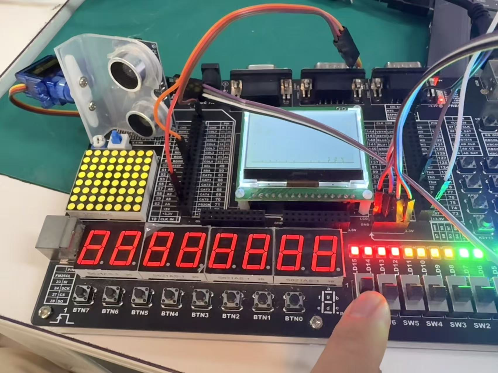
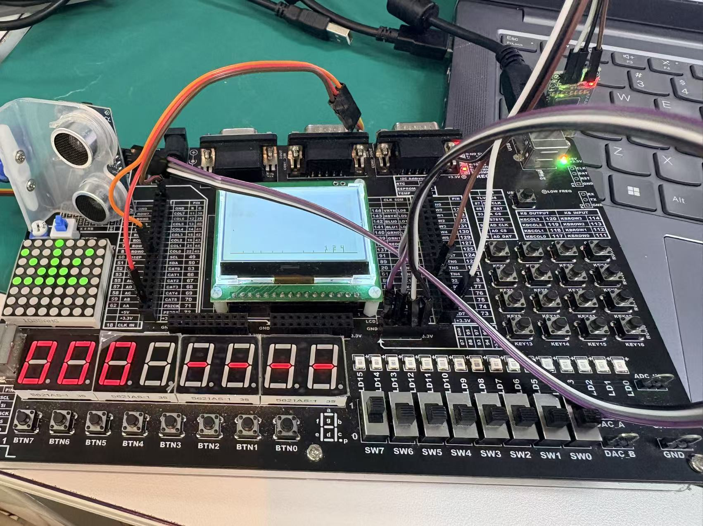
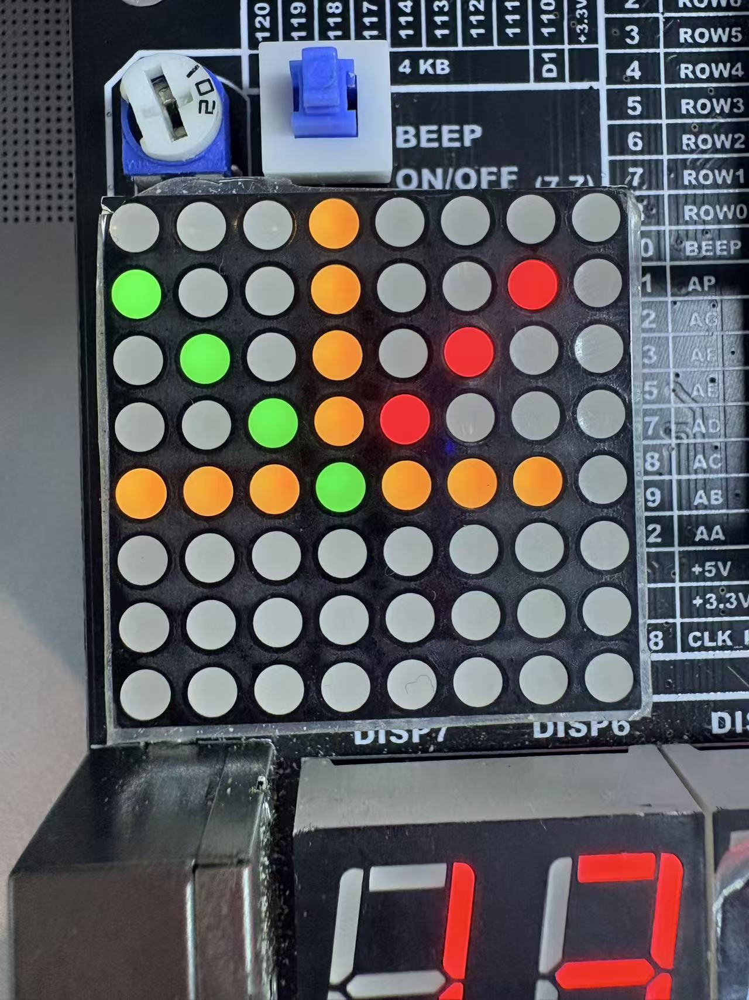
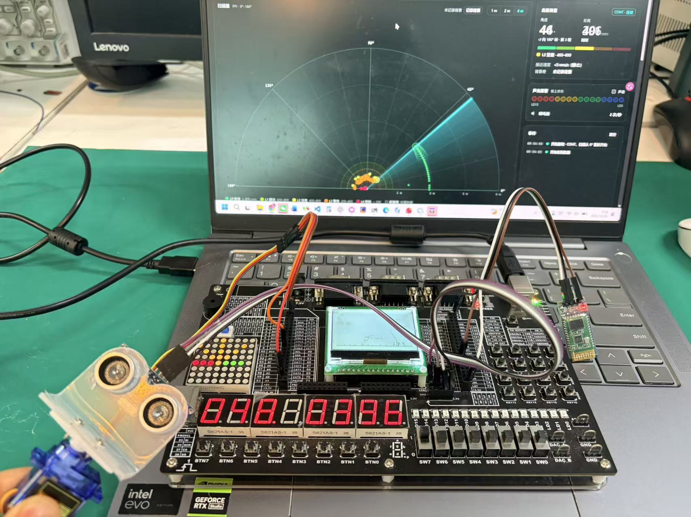
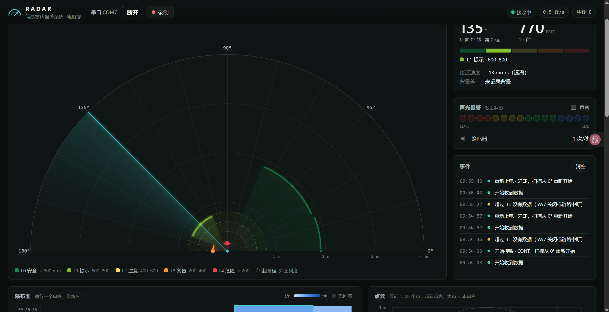

# 简易雷达报警系统

2026 秋《数字电路与逻辑设计实验（下）》题目 2。在 MAX II 实验板（EPM1270T144C5）上用 Verilog 实现：
舵机带着超声波模块来回扫描，测出每个方向的距离，用数码管、8×8 点阵、LED、蜂鸣器和 LCD12864 显示和报警；
同时把测量结果经串口（HC-06 蓝牙）发给电脑，电脑端有一个浏览器界面做实时可视化。

```
HC-SR04 ─┐                         ┌─ 数码管：角度 + 距离
SG90  ───┤   EPM1270 (Verilog)     ├─ 点阵：5 个方向按距离着色
BTN0/SW7 ┘   radar_system          ├─ 16 LED + 蜂鸣器：分级声光报警
                                   ├─ LCD12864：雷达扫描图
                                   └─ 串口 TX ─► HC-06 ─蓝牙─► 电脑 tools/radar_viz（浏览器界面）
```

## 效果

| 开机自检 | 待机 | STEP 扫描：点阵按距离着色 |
|---|---|---|
|  |  |  |

| CONT 连续扫描：LCD 雷达图与电脑端同步 | 电脑端 radar_viz |
|---|---|
|  |  |

更多截图：[分析图表](docs/images/viz_charts.png) · [入侵检测](docs/images/viz_intrusion.png) · [编译报告](docs/images/quartus_flow_summary.png)

## 1. 接线

### 外接模块（杜邦线接到板上排针）

| 模块 | 模块引脚 | 接到 |
|---|---|---|
| **HC-SR04** 超声波 | VCC | 3.3V |
| | GND | GND |
| | Trig | 排针 **94** |
| | Echo | 排针 **95** |
| **SG90** 舵机 | 棕（GND） | GND |
| | 红（VCC） | **+5V** |
| | 橙（Signal） | 排针 **51**（与数码管小数点共用，程序里不驱动小数点） |
| **HC-06** 蓝牙（只发不收） | VCC | 3.3V |
| | GND | GND |
| | RXD | 排针上标 **"85 TX1"** 的针 |
| | TXD | 不接 |

> 题目 1 给的蓝牙接法（TXD→95、RXD→94）和超声波冲突，这里不用。
> 舵机转动时电流较大，电源不稳可能导致复位或测距抖动。

### 板上设置

- **时钟选 1MHz**：用板子右上角的 USER_BTN 切换，看频率指示灯（全局时钟输入是 18 脚，整个设计按 1MHz 计时）。
- **SW7**：总开关。
- **BTN0**：STEP / CONT 模式切换键。

数码管、点阵、LED、蜂鸣器、LCD 都是板载器件，不用接线。完整引脚分配见 `radar_system.qsf` 和 `docs/modules.md` 第 2 节。

## 2. 编译和下载

- **GUI**：Quartus II 13.1 打开 `radar_system.qpf` → Compile → Programmer 下载 `output_files/radar_system.pof`。
- **命令行**（Git Bash，在本目录下）：

  ```
  "/d/ProgramFiles/altera/13.1/quartus/bin64/quartus_sh.exe" --flow compile radar_system
  ```

  编译后会有一条 "Timing requirements not met" 的严重警告，可以忽略：工程没有写时序约束，工具按默认 1GHz 检查，
  实际时钟是 1MHz（设计能跑到约 53MHz）。器件只有 1270 个逻辑单元，现在用了约 98%。

## 3. 使用

1. **SW7 拨上**：自检 2 秒——点阵全屏黄色、8 个数码管显示 "8"、16 个 LED，全部 2Hz 闪烁。
2. **待机 2 秒**：点阵显示待机图案，数码管左边 "000"、右边 "----"，舵机回到 0°。
3. **开始扫描**（默认 STEP 模式）：舵机每 2 秒走一步 0°→45°→90°→135°→180°→135°→…，每到一个角度测一次距离。
   - 数码管：左 3 位 = 角度，右 4 位 = 距离（mm），超量程显示 "----"。
   - 点阵：当前角度那条线按距离着色，保持到下一次扫到这个方向。
   - LED + 蜂鸣器：按当前距离报警，越近越急促。
   - LCD：雷达扫描图，37 个方向（每 5°）各画一段弧，半径就是测到的距离。
4. **按 BTN0** 切换到 CONT 模式：0°↔180° 连续往返（每 100ms 走 2°），再按一次切回 STEP。切换时清空已有结果、从 0° 重新开始。
5. **SW7 拨下**：全部熄灭，舵机停止。

距离分级（点阵、LED、蜂鸣器共用）：

| 距离 | 点阵颜色 | LED | 蜂鸣器 |
|---|---|---|---|
| ≥ 800mm 或超量程 | 绿 | 4 个蓝灯常亮 | 不响 |
| 600 ~ 800mm | 黄绿 | 4 个绿灯 2Hz 闪 | 每秒 1 声 |
| 400 ~ 600mm | 黄 | 4 个黄灯 2Hz 闪 | 每秒 2 声 |
| 200 ~ 400mm | 橙 | 4 个红灯 2Hz 闪 | 每秒 4 声 |
| < 200mm | 红 | 16 个灯全部 2Hz 闪 | 常响 |

## 4. 电脑端界面（tools/radar_viz）

FPGA 每测一次就从串口发一行 `A=045 D=0623 L=1`（角度、距离 mm、分级；9600 8N1）。
电脑端解析这些数据，在浏览器里显示雷达扫描图、当前测量、板上 LED / 蜂鸣器的镜像、事件和测量记录，还能录制和回放。

**第一次使用**（需要 Python 3.10+）：

```
pip install -r tools/radar_viz/requirements.txt
```

再在 Windows 蓝牙设置里配对 HC-06，配对码一般是 1234。

**启动**（在本目录下）：

```
python tools/radar_viz/run.py
```

会自动打开 http://127.0.0.1:8765/ 。在顶栏选数据源，点"连接"：

- **串口**：选 "COMx · 蓝牙 · HC-06"，程序会默认选中它。标着"不可用"的是 Windows 给的蓝牙传入端口，不能选。
  蓝牙首次连接要几秒；板子上电、SW7 拨上、开始扫描后就会有数据。
- **模拟器**：不接板子也能看效果，模拟一个有墙、门、柱子和一个走动的人的房间。
- **回放**：连上后点"录制"，数据会存到 `tools/radar_viz/recordings/`，之后可以在这里选择，按 1/2/4/8 倍速重放。

也可以启动时直接指定数据源：`--serial COM7`、`--sim CONT`、`--replay 文件.csv --speed 4`。按 Ctrl+C 退出。
详细说明见 `tools/radar_viz/README.md`。

## 5. 目录

| 路径 | 内容 |
|---|---|
| `radar_system.qpf` / `.qsf` | Quartus 工程与引脚分配 |
| `rtl/radar_system.v` | 顶层 |
| `rtl/*.v` | 20 个功能模块，见 `docs/modules.md` 第 3 节 |
| `sim/tb_*.v` | ModelSim 测试台（输出 `[ok]` / `[FAIL]`，最后打印 `ALL PASS`） |
| `docs/design.md` | 设计方案：状态机、扫描参数、点阵图案、报警规则 |
| `docs/modules.md` | 模块接口、引脚、实现顺序与进度、资源优化记录 |
| `tools/radar_viz/` | 电脑端（Python + 浏览器） |

运行某个测试台（Git Bash，在任意空目录下）：

```
vlib work
vlog <工程目录>/rtl/*.v <工程目录>/sim/tb_top.v
vsim -c tb_top -do "run -all; quit -f"
```

## 许可

[MIT](LICENSE)
